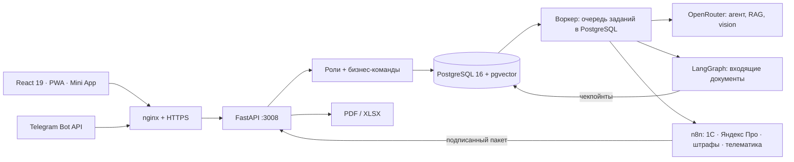

# Таксопарк — операционная система с ИИ-слоем

Концепт и прототип для таксопарка и проката. Внутри:
- автопарк из 160 машин, водители, прокат, выкуп, сторонние владельцы, сервис и финансы;
- поверх них — ИИ-агент, поиск по регламентам, Telegram-бот с Mini App и интеграции на n8n.

Все люди, договоры и операции учебные. Каждый посетитель получает своё пространство с 90 днями истории; роль можно переключать.

**Стенд:** https://fleet.shvarev-demo.ru · **OpenAPI:** https://fleet.shvarev-demo.ru/api/docs

[](https://github.com/ZonaNeona/fleet-ai-ops/actions/workflows/ci.yml)


## Что открыть

Прямые ссылки сразу открывают экран, вход не нужен.

| Ссылка | Что там |
|---|---|
| [`#app/today`](https://fleet.shvarev-demo.ru/#app/today) | Дашборд собственника: выручка, результат после лизинга и расходов, загрузка, долги, экономика каждой машины |
| [`#app/analytics`](https://fleet.shvarev-demo.ru/#app/analytics) | Аналитика: P&L по машинам и группам, распределение общих расходов, возраст долга |
| [`#app/inbox`](https://fleet.shvarev-demo.ru/#app/inbox) | Входящие документы: штраф, счёт СТО, права кандидата → распознавание → сверка с учётом → проводка или решение человека |
| [`#app/crm`](https://fleet.shvarev-demo.ru/#app/crm) | CRM · Битрикс24: воронка найма водителей и проката, лиды, сверка «оплачено в CRM ↔ деньги в учёте», журнал REST-вызовов |
| [`#app/calls`](https://fleet.shvarev-demo.ru/#app/calls) | Звонки диспетчерской: запись → распознавание речи → разбор по чек-листу диспетчера моделью, балл считает код |
| [`#app/bot`](https://fleet.shvarev-demo.ru/#app/bot) | Эмулятор Telegram-бота в рамке телефона: тот же код, что у настоящего бота, Mini App внутри |
| [`#under/map`](https://fleet.shvarev-demo.ru/#under/map) | Инженерная консоль «Под капотом»: как запрос проходит вебхук, очередь, воркер, агента и проверку прав |
| [`#under/rag`](https://fleet.shvarev-demo.ru/#under/rag) | Поиск по регламентам: pgvector + русский полнотекстовый поиск, RRF, проверка ссылок, честный отказ вне базы |
| [`#under/agent`](https://fleet.shvarev-demo.ru/#under/agent) | Агент с восемью инструментами (учёт, регламенты, Битрикс24). Недоступные роли инструменты под замком, запись — только черновиком с подтверждением |
| [`#under/docs`](https://fleet.shvarev-demo.ru/#under/docs) | Граф документов на LangGraph: путь реального документа, `interrupt()` на решении человека, чекпойнты в PostgreSQL |
| [`#under/mcp`](https://fleet.shvarev-demo.ru/#under/mcp) | MCP-сервер: личный ключ к своему демо-пространству, конфиги для Claude Desktop и Cursor, проверка `initialize` / `tools/list` / `tools/call` прямо из консоли |
| [`#under/n8n`](https://fleet.shvarev-demo.ru/#under/n8n) | Настоящие workflow n8n для 1С, Яндекс Про, штрафов и телематики, сверка расхождений, история запусков |
| [`#under/log`](https://fleet.shvarev-demo.ru/#under/log) | Живая лента: ИИ-задания, вебхуки, синхронизации, аудит. Любое событие можно проиграть на холсте |

Сценарий показа на 5 + 5 минут — [docs/DEMO.md](docs/DEMO.md).

## Что настоящее, а что учебное

| Настоящее | Учебное |
|---|---|
| Бизнес-команды, права ролей, учёт денег (Decimal, сторно, закрытые периоды), брони без пересечений на уровне PostgreSQL | Люди, машины с номерами, договоры и операции |
| Вызовы моделей через OpenRouter: стоимость видна в трассе, есть суточный потолок | Источники 1С, Яндекс Про, штрафов и телематики — синтетические снимки в их формате |
| RAG: эмбеддинги MiniLM, pgvector HNSW, FTS, RRF | Регламенты базы знаний написаны для стенда |
| Документы: граф LangGraph, vision-модель для сканов, проводка в учёт | Постановления, счета и права — учебные образцы с водяным знаком |
| Битрикс24: REST-клиент с постраничным чтением, read-only адаптер живого портала по вебхуку | Портал — эмулятор в формате REST Битрикс24, собранный из данных вашего пространства |
| n8n: настоящие webhook / HTTP / Code-узлы, подписанные пакеты | Оплаты и квитанции — учебные, без эквайринга |
| Голос: голосовые в боте и микрофон эмулятора → распознавание речи моделью с аудио-входом; разбор звонков моделью | Записи звонков синтезированы голосами по учебным сценариям |
| Telegram: вебхук с секретом, дедупликация, Mini App с проверкой HMAC | Сценарии бота на схеме «Под капотом» — пошаговая анимация, это подписано на экране |

## Как устроено



Модульный монолит:
- HTTP, Telegram и агент вызывают одни и те же команды из `app/domain.py`.
- Изменение, аудит и исходящее задание фиксируются в одной транзакции.
- Очередь — таблица `jobs` в PostgreSQL с арендой и повторами; отдельный брокер не нужен.
- Модель эмбеддингов загружается коротким отдельным процессом и не держит память постоянно: сервер стенда — 4 ГБ на несколько проектов.

| Каталог | Что внутри |
|---|---|
| `app/` | FastAPI, домен, агент (`agent.py`), RAG (`rag.py`), документы (`inbox.py`, граф — `inbox_graph.py`), CRM (`crm.py`), голос и звонки (`voice.py`, `calls.py`), интеграции (`integrations.py`), бот (`telegram.py`), Mini App, отчёты, воркер |
| `app/kb/` | Регламенты базы знаний (Markdown) |
| `web/` | Кабинет (React 19, TanStack Query), консоль «Под капотом» (`web/under/`, React Flow), Mini App (`web/tg/`) |
| `n8n/` | Генератор workflow и их определения без секретов |
| `migrations/` | Alembic |
| `scripts/` | Выкладка, бэкап, проверка восстановления, оценка ИИ, нагрузка |
| `docs/` | [Предметная модель и правила](docs/DOMAIN.md), [«Под капотом»](docs/UNDER-HOOD.md), [Mini App](docs/MINIAPP.md), [решения (ADR)](docs/adr/) |

## ИИ и бюджет

- **Агент:** восемь инструментов — `get_balance`, `list_vehicles`, `vehicle_economics`, `find_contract`, `search_knowledge`, `create_ticket`, `crm_pipeline`, `crm_task`.
  - Набор инструментов зависит от роли; каждый вызов заново проверяет права.
  - Денег и договоров модель не меняет: заявку и задачу в Битрикс24 создаёт человек кнопкой «Подтвердить».
- **RAG:** гибридный поиск, порог cosine 0,38.
  - Если не найдено ни одного фрагмента, модель не вызывается.
  - Ссылки в ответе сверяются с найденными фрагментами.
- **Бюджет:**
  - перед вызовом стоимость резервируется в PostgreSQL под advisory lock;
  - потолок — $0,50 в сутки на весь стенд и 10 ИИ-заданий в час на посетителя;
  - неудачный ответ не подменяется заготовкой.
- **Документы:** граф LangGraph `read → classify → validate → review | post`.
  - Текстовый слой PDF читается правилами, фото и сканы — vision-моделью (до 5 документов в сутки на посетителя).
  - Сверка с учётом: машина по госномеру, договор на дату нарушения, ремонт и смета, дубли (в том числе с данными ГИБДД из n8n), закрытый период.
  - Если что-то не сошлось — `interrupt()`: состояние в PostgreSQL, решение человека продолжает тот же запуск.
- **MCP:** `POST /api/mcp` (Streamable HTTP, JSON-RPC) и stdio (`python -m app.mcp`). Инструменты и схемы берутся из того же реестра, что у встроенного агента; ключ на 24 часа привязан к демо-пространству посетителя.
- **Качество:**
  - `scripts/eval_ai.py` — 60 проверок ответов; выбирается самая дешёвая модель, прошедшая порог 90% и все критичные отказы.
  - `python -m app.quality` — поиск по 17 эталонным вопросам (hit@1, hit@3, MRR) и 3 вопросам вне базы; бесплатно, запускается в CI и при каждой выкладке, результат — `GET /api/v1/quality`.

## Запуск

Локально — фронтенд против живого API:

```bash
npm ci
API_TARGET=https://fleet.shvarev-demo.ru npm run dev
```

Сервер: Ubuntu, PostgreSQL 16 + pgvector, Node 22, pm2, nginx. Первый раз — `scripts/setup.sh`, дальше релизы одной командой:

```bash
bash scripts/pack.sh                                   # локально: сборка + архив
scp fleet-release.tar.gz scripts/deploy.sh root@host:/tmp/
ssh root@host bash /tmp/deploy.sh /tmp/fleet-release.tar.gz   # бэкап, снимок, миграции, рестарт, health
```

Конфигурация — `/etc/fleet.env`, образец — [config.example.env](config.example.env). Секрет интеграций — `/etc/fleet-integrations.env`. В репозитории секретов нет.

## Проверки

```bash
pytest -q                                   # домен, интеграции, Mini App, консоль, бот (нужен PostgreSQL)
npm run build                               # tsc + сборка
npx playwright test                         # браузерные сценарии против стенда
PYTHONPATH=. python scripts/eval_ai.py      # оценка моделей (платные вызовы)
bash scripts/restore_check.sh               # бэкап восстанавливается и совпадает с живой БД
```

CI на каждый push:
- pytest на PostgreSQL с pgvector;
- сборка фронтенда;
- gitleaks;
- проверка, что в репозиторий не попали приватные имена.

## Дорожная карта

Стенд развивается под типовые запросы заказчиков. Каждый пункт — сценарий таксопарка, а не модуль ради стека.

1. ~~**Входящие документы на графе**~~ — сделано: фото и PDF → распознавание → сверка с учётом → решение человека → проводка.
2. ~~**CRM**~~ — сделано: воронки найма и проката из Битрикс24, лиды, сверка «оплачено в CRM ↔ деньги в учёте», задачи менеджеру через агента.
3. ~~**Голос**~~ — сделано: голосовые в боте и микрофон эмулятора → распознавание речи → тот же маршрут, что у текста; разбор звонков диспетчерской по чек-листу.
4. ~~**MCP и качество**~~ — сделано: MCP-сервер над инструментами агента, измеренное качество поиска в CI и при выкладке.
5. **Как мы работаем:** раздел «Как мы работаем» и утренняя сводка собственнику.

## Границы прототипа

- Электронной подписи, банковских транзакций и реальной телеметрии нет; карта показывает площадки схематически.
- До внедрения нужны SSO для сотрудников, юридическая проверка тарифов, внешние резервные копии и договоры с провайдерами.

Подробно — [docs/DOMAIN.md](docs/DOMAIN.md).

Автор — Игорь Шварёв. Лицензия MIT.
