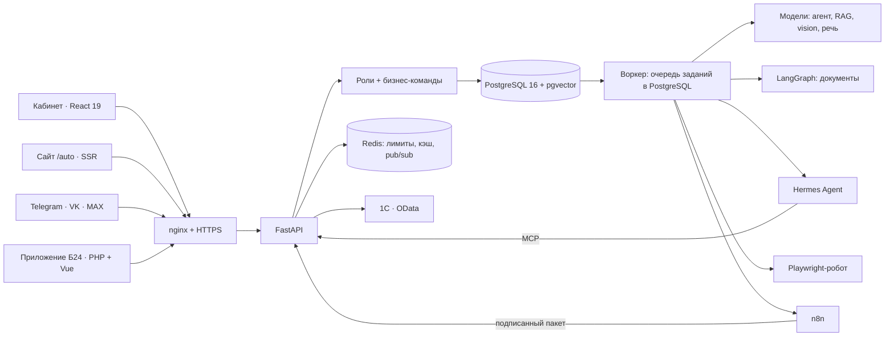

# Таксопарк — операционная система с ИИ-слоем

Концепт и рабочий прототип для таксопарка и проката:
- **учёт:** 160 машин, водители, прокат, выкуп, сторонние владельцы, сервис и финансы;
- **ИИ-слой:** агент с инструментами, поиск по регламентам, разбор документов и звонков;
- **каналы:** Telegram-бот с Mini App, клиентский сайт, приложение Битрикс24;
- **интеграции:** n8n, 1С по OData, онлайн-оплаты.

Все люди, договоры и операции учебные. Каждый посетитель получает своё пространство с 90 днями истории; роль переключается в шапке.

**Стенд:** https://fleet.shvarev-demo.ru · **OpenAPI:** https://fleet.shvarev-demo.ru/api/docs · **Сценарий показа:** [docs/DEMO.md](docs/DEMO.md)

[](https://github.com/ZonaNeona/fleet-ai-ops/actions/workflows/ci.yml)


## Что открыть

Прямые ссылки сразу открывают нужный экран, вход не нужен.

**Продукт**

| Ссылка | Что там |
|---|---|
| [`#app/today`](https://fleet.shvarev-demo.ru/#app/today) | Дашборд собственника: выручка, результат после лизинга и расходов, загрузка, долги, экономика каждой машины, блок «Сделать сейчас», выгрузка в XLSX |
| [`#app/analytics`](https://fleet.shvarev-demo.ru/#app/analytics) | P&L по машинам и группам, распределение общих расходов, возраст долга |
| [`#app/inbox`](https://fleet.shvarev-demo.ru/#app/inbox) | Входящие документы (фото, PDF, письмо): распознавание → сверка с учётом → проводка или решение человека |
| [`#app/crm`](https://fleet.shvarev-demo.ru/#app/crm) | Битрикс24: воронки найма и проката, сверка «оплачено в CRM ↔ деньги в учёте», журнал REST; приложение на PHP + Vue в карточке сделки и робот «Проверить водителя» |
| [`#app/onec`](https://fleet.shvarev-demo.ru/#app/onec) | Обмен с 1С по OData: выгрузка начислений и оплат документами, повтор без дублей, сверка в обе стороны |
| [`#app/calls`](https://fleet.shvarev-demo.ru/#app/calls) | Звонки диспетчерской: запись → распознавание → разбор по чек-листу; вебхук виртуальной АТС → дело-звонок в Битрикс24 |
| [`#app/bot`](https://fleet.shvarev-demo.ru/#app/bot) | Telegram-бот в рамке телефона (тот же код, что у настоящего), Mini App внутри, тот же сценарий для VK и MAX |
| [`/auto`](https://fleet.shvarev-demo.ru/auto) | Клиентский сайт «Аренда и выкуп»: серверные страницы, каталог, календарь занятости, заявка → лид и сделка в Битрикс24 |
| [`#app/work`](https://fleet.shvarev-demo.ru/#app/work) | «Как мы работаем»: этапы, разработка с ИИ-агентами, измеренное качество кода |

**Под капотом** — инженерная консоль: каждый механизм на холсте, по настоящим трассам

| Ссылка | Что там |
|---|---|
| [`#under/map`](https://fleet.shvarev-demo.ru/#under/map) | Как запрос проходит вебхук, очередь, воркер, агента и проверку прав |
| [`#under/rag`](https://fleet.shvarev-demo.ru/#under/rag) | Поиск по регламентам: pgvector + полнотекстовый поиск, RRF, проверка ссылок, отказ вне базы |
| [`#under/agent`](https://fleet.shvarev-demo.ru/#under/agent) | Агент с девятью инструментами и маршрутизатором: быстрый ответ без модели → регламенты → Hermes Agent через MCP → встроенный цикл |
| [`#under/docs`](https://fleet.shvarev-demo.ru/#under/docs) | Граф документов на LangGraph: `interrupt()` на решении человека, чекпойнты в PostgreSQL |
| [`#under/n8n`](https://fleet.shvarev-demo.ru/#under/n8n) | Workflow n8n для 1С, Яндекс Про, штрафов и телематики, история запусков |
| [`#under/robot`](https://fleet.shvarev-demo.ru/#under/robot) | Playwright-робот на учебном портале штрафов: капча-заглушка, пагинация, сбои 503/429, снимок каждого шага |
| [`#under/mcp`](https://fleet.shvarev-demo.ru/#under/mcp) | MCP-сервер: ключ к своему пространству, конфиги для Claude Desktop и Cursor, проверка прямо из консоли |
| [`#under/ops`](https://fleet.shvarev-demo.ru/#under/ops) | Эксплуатация: задержки, очередь, Redis, журнал онлайн-оплат; [`/api/metrics`](https://fleet.shvarev-demo.ru/api/metrics) для Prometheus |
| [`#under/log`](https://fleet.shvarev-demo.ru/#under/log) | Живая лента событий; любое можно проиграть на холсте |

## Что настоящее, а что учебное

| Настоящее | Учебное |
|---|---|
| Бизнес-команды, права ролей, учёт денег (Decimal, сторно, закрытые периоды), брони без пересечений на уровне PostgreSQL | Люди, машины с номерами, договоры и операции |
| Вызовы моделей: стоимость в трассе, суточный потолок расходов | Регламенты базы знаний написаны для стенда |
| RAG: эмбеддинги MiniLM, pgvector HNSW, русский FTS, RRF | — |
| Документы: граф LangGraph, vision-модель для сканов, проводка в учёт | Постановления, счета и права — образцы с водяным знаком |
| Битрикс24: REST-клиент, приложение на PHP + Vue, робот; живой портал по вебхуку, запись только с `BITRIX24_WRITE=1` | Портал — эмулятор в формате REST Битрикс24 из данных пространства |
| 1С: OData-клиент (`$filter`, постранично, POST и `Post()`), идемпотентная выгрузка, сверка; живая база по `ONEC_ODATA_URL` | База 1С — эмулятор того же протокола |
| n8n: webhook / HTTP / Code-узлы, подписанные пакеты, ветка ошибки | Яндекс Про, штрафы и телематика — синтетические снимки в их формате |
| Платежи: `Idempotence-Key`, перечитывание платежа у провайдера, проводка, возврат сторно; адаптер ЮKassa и Telegram Payments | Магазин ЮKassa — эмулятор API v3; деньги не списываются |
| Telegram: вебхук с секретом, дедупликация, Mini App с проверкой HMAC; VK и MAX на том же ядре | Отправка в VK и MAX на стенде показана, но не подключена |
| Голос: распознавание речи моделью с аудио-входом; разбор звонков по чек-листу | Записи звонков синтезированы по учебным сценариям |
| Redis: лимиты, кэш отчёта, pub/sub живой ленты; Prometheus, Grafana, Sentry по DSN | — |
| Playwright-робот: повторы, троттлинг, снимки шагов | Портал штрафов — учебный, на самом стенде |

## Как устроено



Модульный монолит:
- HTTP, Telegram, MCP и агент вызывают одни и те же команды из `app/domain.py`.
- Изменение, аудит и исходящее задание фиксируются в одной транзакции.
- Очередь — таблица `jobs` в PostgreSQL с арендой и повторами; Redis отвечает только за лимиты, кэш и живую ленту (ADR 0002, 0012).
- Модель эмбеддингов загружается коротким отдельным процессом и не держит память: сервер стенда — 4 ГБ на несколько проектов (ADR 0004).
- Каждая внешняя система — порт с эмулятором и живым режимом по ключу (ADR 0007).

Решения с обоснованием — [docs/adr/](docs/adr/), 15 записей.

### Код

| Каталог | Что внутри |
|---|---|
| `app/` | Ядро: `api.py` (HTTP), `domain.py` (команды), `db.py` (модель данных), `worker.py` (очередь), `seed.py` (учебная компания), `reports.py` |
| | ИИ: `ai.py` (цепочка моделей и бюджет), `agent.py` (реестр инструментов), `quick.py`, `hermes.py`, `signals.py`, `rag.py`, `quality.py`, `mcp.py` |
| | Документы и голос: `inbox.py`, `inbox_graph.py` (LangGraph), `documents.py` (PDF/XLSX), `voice.py`, `calls.py`, `telephony.py` |
| | Интеграции: `crm.py`, `b24.py` (Битрикс24), `onec.py` (1С), `integrations.py` (n8n), `payments.py`, `mail.py`, `sheets.py`, `robot.py`, `gov.py` (учебный портал) |
| | Каналы: `telegram.py`, `miniapp.py`, `channels.py` (VK, MAX), `site.py` + `templates/` (сайт), `under.py` (консоль), `ops.py` (Redis, метрики, Sentry) |
| `app/kb/` | Регламенты базы знаний (Markdown) |
| `web/` | Кабинет (React 19, TanStack Query, Tailwind 4), консоль «Под капотом» (`web/under/`, React Flow), Mini App (`web/tg/`) |
| `b24app/` | Приложение Битрикс24: PHP 8.3 (установка, события, робот, API встройки) и Vue 3 (вкладка «Водитель» в сделке) |
| `n8n/` | Генератор workflow и их определения без секретов |
| `migrations/` | Alembic |
| `tests/` | pytest на PostgreSQL (домен, интеграции, каналы, агент), браузерные сценарии Playwright (`tests/browser/`) |
| `infra/` | nginx, Prometheus, дашборд Grafana, профиль Hermes Agent |
| `scripts/` | Установка, выкладка, бэкап и проверки на живом стенде — см. ниже |
| `tools/` | Отчёт о качестве кода, проверка репозитория на приватные имена |
| `CLAUDE.md` | Правила проекта для ИИ-агентов, с которыми пишется код |

Документация: [предметная модель и правила](docs/DOMAIN.md) · [«Под капотом»](docs/UNDER-HOOD.md) · [Mini App](docs/MINIAPP.md) · [сценарий показа](docs/DEMO.md).

## ИИ и бюджет

- **Агент:** девять инструментов — `get_balance`, `list_vehicles`, `vehicle_economics`, `find_contract`, `search_knowledge`, `create_ticket`, `crm_pipeline`, `crm_task`, `get_signals`.
  - Набор зависит от роли; каждый вызов заново проверяет права.
  - Деньги и договоры модель не меняет: заявку и задачу в Битрикс24 создаёт человек кнопкой «Подтвердить».
  - Маршрутизатор (ADR 0014): частый вопрос — ответ инструментом без модели; вопрос о правилах — база знаний; остальное — Hermes Agent через MCP, при его недоступности — встроенный цикл.
- **RAG:** гибридный поиск, порог cosine 0,38. Если ничего не найдено, модель не вызывается. Ссылки в ответе сверяются с найденными фрагментами.
- **Документы:** граф `read → classify → validate → review | post`.
  - Текстовый слой PDF читается правилами, фото и сканы — vision-моделью.
  - Сверка с учётом: машина по госномеру, договор на дату нарушения, смета ремонта, дубли, закрытый период.
  - Если что-то не сошлось — `interrupt()`; решение человека продолжает тот же запуск.
  - Документы с персональными данными можно направить в локальную модель (`PII_LOCAL=1`, Ollama; профиль compose `local-llm`).
- **Бюджет:** стоимость резервируется в PostgreSQL под advisory lock до вызова; потолок — $0,50 в сутки на стенд и 10 ИИ-заданий в час на посетителя. Неудачный ответ не подменяется заготовкой.
- **MCP:** `POST /api/mcp` (Streamable HTTP) и stdio (`python -m app.mcp`). Инструменты — из того же реестра, что у встроенного агента; ключ на 24 часа привязан к пространству посетителя.
- **Качество:**
  - `python -m app.quality` — поиск по 17 эталонным вопросам (hit@1, hit@3, MRR) и 3 вопросам вне базы; в CI и при каждой выкладке, результат — `GET /api/v1/quality`;
  - `scripts/eval_ai.py` — 60 проверок ответов; выбирается самая дешёвая модель, прошедшая порог 90% и все критичные отказы.

## Запуск

Весь стенд одной командой — PostgreSQL + pgvector, Redis, API, воркер, приложение Битрикс24 и веб. Интеграции работают в режиме эмуляторов, ключи не нужны:

```bash
docker compose up --build        # → http://localhost:8080
```

Для ответов моделей положите `OPENROUTER_API_KEY` в `.env` рядом с `docker-compose.yml`. Без ключа стенд работает, а ИИ сообщает, что модель не подключена.

Дополнительные профили:

```bash
docker compose --profile observability up   # + Prometheus и Grafana (http://localhost:3000)
docker compose --profile local-llm up       # + Ollama для документов с персональными данными
```

Только фронтенд против живого API:

```bash
npm ci
API_TARGET=https://fleet.shvarev-demo.ru npm run dev
```

### Сервер

Ubuntu, PostgreSQL 16 + pgvector, Redis, Node 22, PHP 8.3-FPM, pm2, nginx. Конфигурация — `/etc/fleet.env` (образец — [config.example.env](config.example.env)), секрет интеграций — `/etc/fleet-integrations.env`. В репозитории секретов нет.

Первая установка:

| Скрипт | Что делает |
|---|---|
| `scripts/setup.sh` | Системный пользователь, база и роль, `/etc/fleet.env`, зависимости, миграции, база знаний, конфиг nginx |
| `scripts/setup_n8n.sh` | Собственный n8n стенда с четырьмя workflow |
| `scripts/setup_b24app.sh` | PHP-FPM и маршруты nginx для приложения Битрикс24 |
| `scripts/setup_site.sh` | Маршруты nginx клиентского сайта |
| `scripts/setup_hermes.sh` | Профиль Hermes Agent и его systemd-служба |
| `scripts/connect_telegram.py` | Команды и кнопка Mini App у бота |

Релиз:

```bash
bash scripts/pack.sh                                     # локально: тесты PHP, сборка, архив
scp fleet-release.tar.gz root@host:/tmp/
ssh root@host 'cd /var/www/fleet && bash scripts/deploy.sh /tmp/fleet-release.tar.gz --quality'
```

`deploy.sh` делает бэкап и снимок релиза, применяет миграции, перезапускает процессы и проверяет `/api/health`. С `--quality` прогоняет тесты на временной базе и обновляет экран «Код и качество», с `--kb` — пересобирает базу знаний. Откат — из каталога, записанного в `LAST_RELEASE`.

## Проверки

```bash
ruff check app scripts tests tools migrations && ruff format --check app scripts tests tools migrations
mypy
npm run format:check && npm run build       # prettier, tsc, сборка
pytest -q                                   # нужен PostgreSQL с pgvector (или docker compose)
npx playwright test                         # браузерные сценарии против стенда
```

CI на каждый push: ruff и mypy; pytest на PostgreSQL с покрытием и замером качества поиска; prettier, tsc и сборка; PHP-тесты и сборка виджета Битрикс24; запуск всего стенда через `docker compose` и проверка health; gitleaks; проверка на приватные имена.

Проверки на живом стенде (запускаются на сервере, результаты — в `reports/`):

| Скрипт | Что проверяет |
|---|---|
| `scripts/under_live_check.py` | Настоящие вызовы модели и локальный RAG |
| `scripts/bot_smoke.py`, `scripts/check_bot_question.py` | Сценарии бота без отправки в Telegram |
| `scripts/check_integrations.py`, `scripts/check_integration_failure.py` | Четыре workflow n8n и их ветка ошибки |
| `scripts/check_rag.py` | Поиск по эталонным вопросам и память процесса |
| `scripts/vision_check.py` | Распознавание учебного счёта vision-моделью |
| `scripts/load_check.py`, `scripts/scale_check.py` | Задержки под нагрузкой и отчёт на 4 000 машин |
| `scripts/eval_ai.py` | 60 проверок ответов и выбор модели |
| `scripts/restore_check.sh` | Бэкап восстанавливается и совпадает с живой базой |

## Границы прототипа

- Электронной подписи, банковского эквайринга и реальной телеметрии нет; карта показывает площадки схематически.
- Роли переключаются в шапке — это режим показа, а не авторизация сотрудников.
- До внедрения нужны SSO для сотрудников, юридическая проверка тарифов, внешние резервные копии и договоры с провайдерами.

Подробно — [docs/DOMAIN.md](docs/DOMAIN.md).

Автор — Игорь Шварёв. Лицензия MIT.
